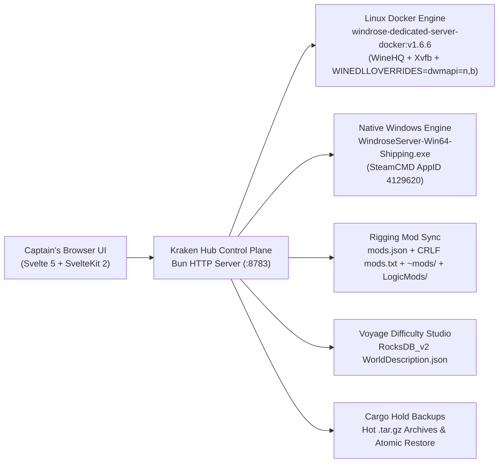

# ⚓ The Kraken — Windrose Dedicated Server Manager & Web Control Plane

> **Open-source, self-hosted fleet manager for [Windrose](https://store.steampowered.com/app/3041230/Windrose/) dedicated servers (`Steam AppID 4129620`) on Linux (Docker) and Native Windows.**
> Commission multi-world servers in one click, drag-and-drop UE4SS & Unreal `.pak` mods, tune RocksDB difficulty without save clobbering, and stream logs or hot-tar backups directly from your browser — zero SSH required.

[](https://thekraken.cloud/)
[](https://demo.thekraken.cloud/)
[](https://github.com/C9RE/Kraken/releases/latest)
[](https://github.com/UberDudePL/windrose-dedicated-server-docker)
[](https://store.steampowered.com/app/3041230/Windrose/)
[](https://bun.sh)
[](LICENSE)

[🌐 Official Website](https://thekraken.cloud/) · [🎮 Interactive Sandbox Demo](https://demo.thekraken.cloud/) · [📦 Latest Release (`v1.8.0`)](https://github.com/C9RE/Kraken/releases) · [📜 Changelog](CHANGELOG.md) · [🐛 Issues](https://github.com/C9RE/Kraken/issues)

---

## ⚡ 1-Line Quick Install

### 🐧 Linux (Docker Engine + Compose v2)
```bash
curl -fsSL https://thekraken.cloud/install.sh | bash
```

### 🪟 Windows (Native Win32 Engine — Zero Wine / WSL2 Overhead)
```powershell
irm https://thekraken.cloud/install.ps1 | iex
```

---

## 📊 Why The Kraken?

| Capability | ⚓ The Kraken (`MIT`) | Manual Docker / SSH | Rented Game Server Host |
|---|---|---|---|
| **Monthly Cost** | **$0** (Your hardware) | $0 (High ops maintenance) | $15–$40 / mo per server |
| **Multi-Server Drydock** | **Auto UDP port-offset UI** (`:7777`, `:7787`…) | Manual YAML + firewall edits | Extra subscription per world |
| **UE4SS & `.pak` Mod Manager** | **Drag-and-drop + dual-sync JSON/CRLF TXT** | Manual SFTP + error-prone edits | Partial or ticket-gated |
| **RocksDB Save Protection** | **Write-locked while running** (zero clobber) | Risk of silent overwrite | Generic INI form |
| **Hot Backups & Restore** | **Live `.tar.gz` + 1-click browser restore** | Custom cron + manual untar | Locked vendor snapshots |
| **Supported Engines** | **Linux Docker (`v1.6.6`) + Native Win32** | Linux Docker CLI only | Shared virtualized vCPU |

---

## 🧭 Architecture Overview



Built on top of [`UberDudePL/windrose-dedicated-server-docker`](https://github.com/UberDudePL/windrose-dedicated-server-docker). The SvelteKit control plane lives in [`hub/`](hub/) and the static documentation landing site lives in [`site/`](site/).

---

## ⚓ Core Features

Each dedicated server ("ship") runs in an isolated directory under `$KRAKEN_FLEET_ROOT/<ship-id>/` with independent save files, SteamCMD downloads, mod configurations, and backup archives:

- **🚢 Fleet Harbor (`/`)** — Real-time fleet overview with search & status filters (`All`, `Afloat`, `Moored`), aggregate crew capacity telemetry, container uptime/health badges, 1-click clipboard copy for matchmaking **Invite Codes** and **Direct UDP `IP:Port`** endpoints, and 1-click lifecycle actions (`Cast off`, `Restart`, `Moor`).
- **🏗️ Drydock (`/new`)** — Commission a new Windrose dedicated server without touching YAML. Scans existing ships to allocate collision-free UDP port pairs (`7777/7778`, `7787/7788`, `7797/7798`), presets crew capacity (`2p`–`16p`), selects latency region (`Auto`, `EU`, `SEA`, `CIS`), and generates `.env` + `docker-compose.yml` with `WINEDLLOVERRIDES=dwmapi=n,b`.
- **🏴‍☠️ Rigging Mod Manager (`/ship/:id` → Rigging)** — Drag-and-drop mod installer for UE4SS `.zip` bundles, loose `.lua` scripts, native C++ `.dll` plugins (writes `enabled.txt` sentinels), and Unreal Engine `.pak`/`.ucas`/`.utoc` archives. Automatically detects **WindrosePlus** and avoids touching `UE4SS-settings.ini`.
- **🗺️ Voyage Difficulty Studio (`/ship/:id` → Voyage)** — Tunes `WorldDescription.json` across `RocksDB_v2` save profiles (`Easy`, `Medium`, `Hard`, `Custom`) with sliders for Mob HP/Damage, Ship HP/Damage, Boarding Difficulty, Co-op Scaling, Shared Quests, and Easy Explore. Locked automatically while a server runs so RocksDB never overwrites changes.
- **📦 Cargo Hold (`/ship/:id` → Cargo Hold)** — Creates live compressed `.tar.gz` backups of `data/R5/Saved` and `ServerDescription.json` with 1-click browser downloads and atomic container-safe snapshot restores.
- **📜 Log Book (`/ship/:id` → Log Book)** — Real-time log tailing with search/grep filter, auto-scroll pin, configurable line depth, and 1-click copy.
- **⚙️ System & Self-Updater (`/settings`)** — Built-in Git commit/tag tracker and 1-click `git pull` + `bun run build` + systemd respawn updater.
- **🔐 Security Gate (`/login`)** — Optional scrypt-hashed PIN (4–12 digits) with signed HTTP-only cookies and exponential per-IP rate limiting (5 failures triggers a 15-minute lockout).

---

## 📋 System Requirements

| Requirement | Details |
|---|---|
| **CPU Architecture** | `x86_64` with **AVX / AVX2** instructions (required by Unreal Engine Windrose binary) |
| **Networking** | **Kernel IPv6 enabled** (`ipv6.disable=1` must NOT be set) + `network_mode: host` on Linux |
| **Linux Runtime** | Docker Engine with Compose v2+ (`docker compose version` $\ge$ 2.0) and **Bun $\ge$ 1.0** |
| **Windows Native** | Windows 10/11 or Server 2019+ + SteamCMD + **Bun $\ge$ 1.0** (no Wine/WSL2 needed) |

*Note: On Linux, WineHQ (x86\_64), Xvfb, and SteamCMD are packaged inside `ghcr.io/uberdudepl/windrose-dedicated-server-docker:v1.6.6`. You do not need Wine installed on the host.*

---

## 🚀 Manual Deployment & Configuration

### Run Kraken Hub from Source
```bash
git clone https://github.com/C9RE/Kraken.git
cd Kraken/hub
bun install
bun run build
PORT=8783 bun run start
```
Open `http://<your-server-ip>:8783` in your browser.

### Automated Port Allocation Formula
Drydock prevents UDP bind clashes when running multiple `network_mode: host` servers on the same machine by stepping in blocks of `10`:
- Vessel 1: `PORT=7777` / `QUERYPORT=7778`
- Vessel 2: `PORT=7787` / `QUERYPORT=7788`
- Vessel 3: `PORT=7797` / `QUERYPORT=7798`

### Hub Environment Variables

| Variable | Default | Description |
|---|---|---|
| `KRAKEN_FLEET_ROOT` | `./fleet` | Directory where commissioned ship stacks and saves live |
| `KRAKEN_TEMPLATE` | `..` (repo root) | Path to template `docker-compose.yml` |
| `PORT` | `8783` | HTTP listening port for Kraken Hub |
| `HOST` | `0.0.0.0` | HTTP bind address |
| `KRAKEN_ENGINE` | `docker` (auto on Win32) | Set `native` to force bare-metal `WindroseServer-Win64-Shipping.exe` supervision |
| `KRAKEN_SYSTEMD_UNIT` | *(empty)* | Systemd unit name (e.g. `kraken-hub`) for 1-click self-update restarts |
| `KRAKEN_GIT_REMOTE` | `origin` | Git remote used for self-updates |
| `KRAKEN_GIT_BRANCH` | `main` | Git branch tracked for self-updates |
| `KRAKEN_DEMO` | `0` | Set `1` to run an in-memory simulated fleet sandbox |

### Standalone CLI Docker Compose (No Web UI)
```bash
git clone https://github.com/C9RE/Kraken.git
cd Kraken
cp .env.example .env
# Edit .env (IMAGE_TAG=v1.6.6, WINEDLLOVERRIDES=dwmapi=n,b, SERVER_NAME, PORT)
docker compose up -d
```

---

## 🛠️ Mod Installation Matrix

| Upload Format | Destination Path | Activation & Registry Behavior |
|---|---|---|
| `<name>.zip` (UE4SS folder layout) | `data/R5/Binaries/Win64/ue4ss/Mods/<name>/` | Flattened cleanly + dual-synced to `mods.json` & `mods.txt` |
| `<name>.zip` (Unreal Pak archive) | `data/R5/Content/Paks/~mods/` (or `LogicMods/`) | Extracts `.pak` + `.ucas`/`.utoc` siblings together |
| `<name>.lua` (Loose Lua script) | `data/R5/Binaries/Win64/ue4ss/Mods/<name>/Scripts/main.lua` | Registered in `mods.json` & CRLF `mods.txt` |
| `<name>.dll` (Native C++ mod) | `data/R5/Binaries/Win64/ue4ss/Mods/<name>/dlls/main.dll` | Writes per-mod `enabled.txt` sentinel automatically |
| `<name>.pak` (`~mods` / `LogicMods`) | `data/R5/Content/Paks/~mods/` or `LogicMods/` | Engine or `BPModLoaderMod` autoloads on boot |

> **Registry Lockstep Rule:** Kraken writes both `mods.json` (authoritative JSON array for UE4SS 3.x) and CRLF `mods.txt`, always preserving `; Built-in keybinds, do not move up!` and `Keybinds : 1` at the tail. Headless Docker containers include `WINEDLLOVERRIDES=dwmapi=n,b` so Wine injects UE4SS cleanly.

---

## 📡 REST API Summary

- `GET /api/fleet` · `POST /api/fleet` — List commissioned ships or drydock a new ship stack.
- `GET /api/fleet/:id` · `POST /api/fleet/:id` — Inspect ship config/backups or run actions (`start`, `stop`, `restart`, `pull`, `refit`, `backup`, `restore`, `update_env`, `scuttle`).
- `GET /api/fleet/:id/logs?lines=200` — Stream Docker container or native `R5.log` output.
- `GET /api/fleet/:id/mods` · `POST /api/fleet/:id/mods` · `POST /api/fleet/:id/mods/:name` — List, upload, toggle, or remove UE4SS and `.pak` mods.
- `GET /api/fleet/:id/voyage` · `POST /api/fleet/:id/voyage` — Inspect and tune RocksDB `WorldDescription.json` settings.
- `GET /api/fleet/:id/backups/:filename` — Stream `.tar.gz` world save snapshots for download.
- `GET /api/system` · `POST /api/system` — Check Git remote updates and trigger 1-click Hub upgrades.

---

## ❓ Frequently Asked Questions

<details>
<summary><strong>Which Steam AppID and container image version does Kraken use?</strong></summary>

Kraken deploys Windrose Dedicated Server (`Steam AppID 4129620`) defaulting to [`ghcr.io/uberdudepl/windrose-dedicated-server-docker:v1.6.6`](https://github.com/UberDudePL/windrose-dedicated-server-docker) (which forces `+@sSteamCmdForcePlatformType windows` and `.windrose-backup-v2` save recovery) or downloads AppID `4129620` directly in Native Windows mode.
</details>

<details>
<summary><strong>Why is WINEDLLOVERRIDES=dwmapi=n,b included in Docker Compose?</strong></summary>

RE-UE4SS loads into the Unreal Engine server process via a proxy `dwmapi.dll`. Without `WINEDLLOVERRIDES=dwmapi=n,b`, Wine ignores the local DLL override and UE4SS mods will silently fail to initialize in headless Linux containers.
</details>

<details>
<summary><strong>How do I try Kraken without installing anything first?</strong></summary>

Visit [**demo.thekraken.cloud**](https://demo.thekraken.cloud/) — it runs the full compiled Kraken Hub UI against an in-memory multi-vessel sandbox with pre-seeded RocksDB saves, UE4SS mods, logs, and Cargo Hold backups.
</details>

---

## 📄 License & Credits

- **License:** [MIT License](LICENSE)
- **Parent Docker Image:** [UberDudePL/windrose-dedicated-server-docker](https://github.com/UberDudePL/windrose-dedicated-server-docker)
- **Mod Loader:** [UE4SS-RE/RE-UE4SS](https://github.com/UE4SS-RE/RE-UE4SS)
- **Framework Reference:** [HumanGenome/WindrosePlus](https://github.com/HumanGenome/WindrosePlus)
- **Maintained By:** [C9RE](https://c9re.dev/) · [thekraken.cloud](https://thekraken.cloud/)
